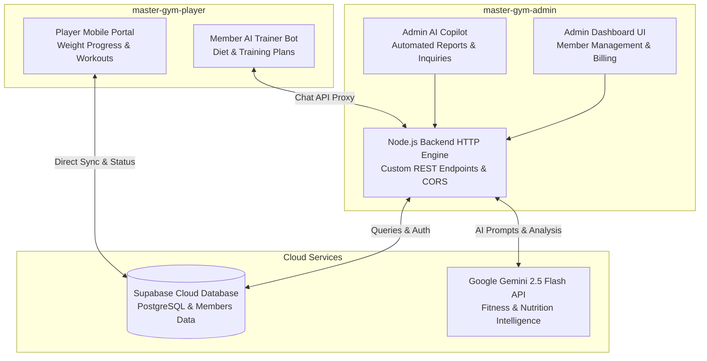

# 🏋️ Master Gym - AI-Powered Fitness & Club Management Platform

<div align="center">


<p align="center">
  <b>A comprehensive gym and fitness center management ecosystem featuring an intelligent Google Gemini AI assistant for workout coaching, member progress tracking, subscription renewals, and administrative controls.</b>
</p>

[English](#-overview-english) • [العربية](#-نظرة-عامة-باللغة-العربية) • [Architecture](#-system-architecture) • [Key Features](#-core-capabilities) • [Quick Start](#-quick-start--installation)

---

</div>

## 🌐 Overview (English)

**Master Gym** is a complete club management and member engagement solution built for modern fitness facilities. The system is split into two specialized sub-platforms:

1. **`master-gym-admin`**: The administrative command center and Node.js backend. Features subscriber lifecycle management, revenue tracking, automated expiration alerts, and an administrative AI Copilot powered by Google Gemini.
2. **`master-gym-player`**: The mobile-responsive athlete portal where gym members track weight progressions, workout logs, subscription status, and interact with an AI personal trainer.

---

## 🇸🇦 نظرة عامة (باللغة العربية)

**Master Gym** هو نظام رقمي متطور وشامل لإدارة الصالات الرياضية والنوادي الصحية. تم تصميم المشروع بمعمارية مفصولة ذكية تضم:
1. **لوحة تحكم الإدارة وخادم الـ API (`master-gym-admin`)**: خادم متكامل مبني بـ Node.js لإدارة بيانات المشتركين، متابعة تواريخ تجديد الاشتراكات، إصدار الفواتير، ومساعد ذكاء اصطناعي (AI Copilot) للإدارة مدعوم بـ Google Gemini.
2. **بوابة المشتركين واللاعبين (`master-gym-player`)**: واجهة هاتف وتطبيق ويب للاعبين لمتابعة تطور الأوزان، السجلات التدريبية، تفاصيل الاشتراك، والتحدث مع مدرب لياقة بدنية افتراضي ذكي.

---

## 🏗️ System Architecture



---

## ⚡ Core Capabilities

### 1. 🤖 Intelligent Gemini AI Integration
* **Member AI Fitness Coach:** Tailored workout advice, calorie estimation, and custom training routines based on athlete goals and physical metrics.
* **Management Assistant:** Natural language insights for gym managers to query active memberships, attendance patterns, and revenue trends.

### 2. 👑 Complete Club Administration (`master-gym-admin`)
* **Membership Lifecycle:** Create, renew, freeze, and cancel subscriptions with automatic expiry date calculations.
* **Financial Ledger & Reports:** Track cash flow, subscription tiers, pending balances, and member renewals.
* **Attendance & QR Check-In:** Monitor daily gym attendance and peak training hours.

### 3. 📱 Athlete Self-Service Portal (`master-gym-player`)
* **Progress & Metrics Tracker:** Log body measurements, weight updates, and view visual transformation progress.
* **Subscription Transparency:** Members can check remaining days, payment receipts, and locker assignments.
* **Interactive Chat Interface:** Clean, WhatsApp-style interface for real-time fitness queries.

---

## 📂 Repository Structure

```
Master-Gym/
├── .gitignore                   # Excludes node_modules, .env, and build archives
├── package.json                 # Root script runner (start, postinstall, build)
├── HOW_TO_RUN.md                # Detailed local testing and deployment notes
│
├── master-gym-admin/            # Admin Panel & Backend Service
│   ├── server.js                # Core Node.js HTTP server, API routes & Gemini proxy
│   ├── .env.example             # Template for Supabase & Gemini API keys
│   ├── index.html / admin.html  # Modern administrative control panels
│   ├── bot.html                 # Administrative Gemini AI interface
│   ├── css/ & js/               # Stylesheets and management client scripts
│   └── portal.html              # Centralized portal hub
│
└── master-gym-player/           # Athlete PWA Portal
    ├── index.html               # Main mobile-friendly member portal
    ├── css/                     # Athlete UI styles & animations
    └── js/                      # Member logic & Supabase client interface
```

---

## 💻 Quick Start & Installation

### Prerequisites
* [Node.js](https://nodejs.org/) (v16.0+)
* Free [Supabase](https://supabase.com) account
* Free [Google AI Studio](https://aistudio.google.com/) Gemini API Key

### 1. Clone & Install Dependencies
```bash
git clone https://github.com/zaidwork/Master-Gym.git
cd Master-Gym

# Installs root and admin dependencies
npm install
```

### 2. Configure Environment Variables
Inside `master-gym-admin/`:
```bash
cd master-gym-admin
cp .env.example .env
```
Fill in your credentials in `.env`:
```env
PORT=3000
SUPABASE_URL=https://YOUR_PROJECT.supabase.co
SUPABASE_ANON_KEY=YOUR_SUPABASE_ANON_KEY
GEMINI_API_KEY=YOUR_GEMINI_API_KEY
GEMINI_MODEL=gemini-2.5-flash
```

### 3. Launch the Server
From the root directory:
```bash
npm start
```
* **Admin Portal:** Visit `http://localhost:3000`
* **Admin AI Bot:** Visit `http://localhost:3000/bot.html`
* **Athlete Portal:** Open `master-gym-player/index.html` in your browser.

---

## 🔒 Security & Best Practices

* Hardcoded API keys, JWT tokens, and private database credentials have been extracted and sanitized.
* All external credentials are now managed securely through environment variables (`.env`).
* `.env` files and compiled `node_modules` are excluded from version control.

---

## 👨‍💻 Author & Maintainer

**Zaid Bashar Daraghmeh**  
* Full-Stack & AI Systems Engineer  
* GitHub: [@zaidwork](https://github.com/zaidwork)  
* Email: [zaidbashardaraghmeh@gmail.com](mailto:zaidbashardaraghmeh@gmail.com)
